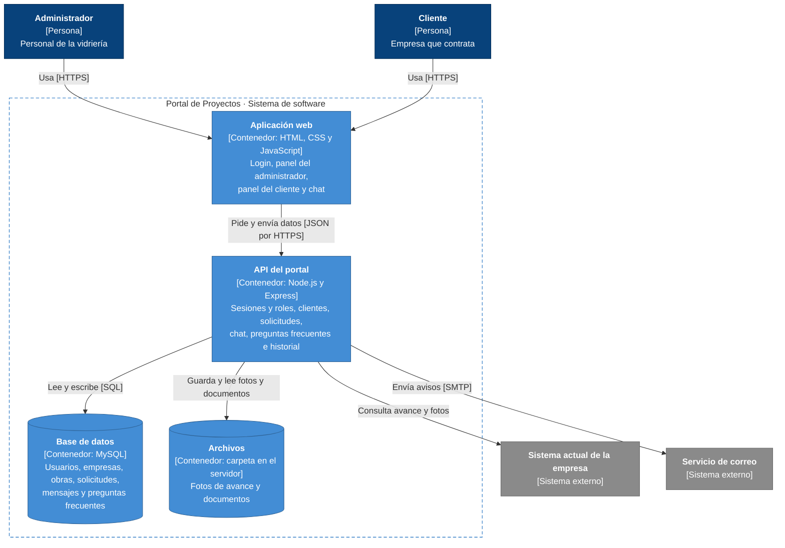

# Diagrama de contenedores (C4, nivel 2)

Módulo de Comunicación con el Cliente · Equipo 3 · Grupo 711

## Qué muestra este diagrama

Este es el nivel 2 del modelo C4. Abre la caja del Portal de Proyectos que aparece en [CONTEXT.md](CONTEXT.md) y muestra sus contenedores: las partes que se ejecutan o guardan datos por separado, con la tecnología de cada una y cómo se comunican.

La propuesta respeta la regla de `AGENTS.md`: las vistas (aplicación web) van separadas de la lógica de conexión (API).

## Diagrama

## Contenedores

> Pendiente: tabla de contenedores (Romina).

## Qué se construye en el prototipo

> Pendiente: alcance del prototipo (Romina).
