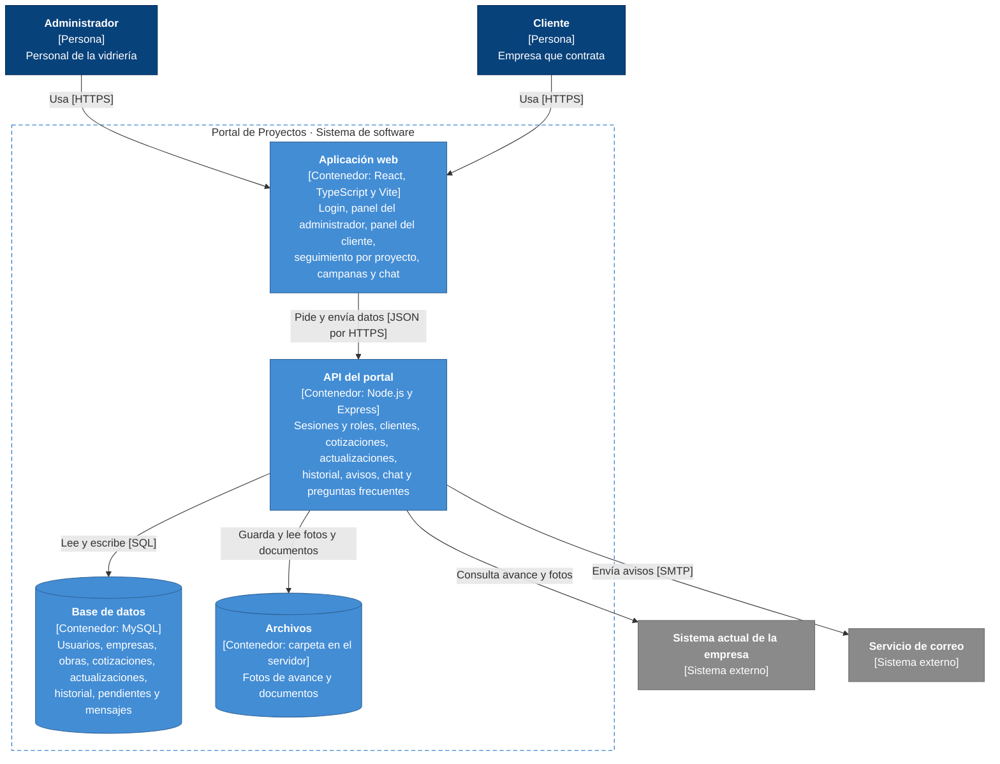

# Diagrama de contenedores (C4, nivel 2)

Módulo de Comunicación con el Cliente · Equipo 3 · Grupo 711

## Qué muestra este diagrama

Este es el nivel 2 del modelo C4. Abre la caja del Portal de Proyectos que aparece en [CONTEXT.md](CONTEXT.md) y muestra sus contenedores: las partes que se ejecutan o guardan datos por separado, con la tecnología de cada una y cómo se comunican.

La propuesta respeta la regla de `AGENTS.md`: las vistas (aplicación web) van separadas de la lógica de conexión (API).

## Diagrama

## **Contenedores**

| Contenedor | Tecnología | Qué hace | Requerimientos |
| :--- | :--- | :--- | :--- |
| Aplicación web | React, TypeScript y Vite | Contiene inicio de sesión, registro, panel del administrador, panel del cliente, seguimiento por proyecto, campanas y chat. Muestra los datos y los envía a la API, sin guardar información por su cuenta. | RNF-01, RNF-05, RNF-06, RF-16, RF-18 |
| API del portal | Node.js con Express | Valida usuarios, contraseñas y roles. Guarda y entrega clientes, cotizaciones, actualizaciones, historial, pendientes y mensajes. Publica lo realizado y pide enviar avisos por correo. | RF-01 a RF-08, RF-13, RF-16 a RF-19, RNF-02, RNF-03 |
| Base de datos | MySQL | Guarda usuarios, empresas, obras, cotizaciones, actualizaciones, historial, pendientes y mensajes durante al menos 12 meses. Se realizan respaldos diarios. | RF-06, RF-16, RF-17, RF-18, RNF-07, RNF-08 |
| Archivos | Carpeta en el servidor (en el despliegue de prueba, Vercel Blob privado) | Guarda fotografías de avance y documentos de cada obra. | RF-07, RF-10 |

## **Qué se construye en el prototipo**

En la Iteración 5 se construirá únicamente la aplicación web. La API y la base de datos se simularán con datos de ejemplo almacenados en un archivo JavaScript independiente, para mantener separadas las vistas y los datos. Cuando se implemente la API real, se sustituirá el archivo que proporciona los datos simulados por la conexión correspondiente, sin necesidad de rehacer las pantallas.

Las pantallas del prototipo serán las definidas en `docs/diseno`:

- Inicio de sesión.
- Panel del administrador.
- Panel del cliente.
- Chat del administrador con lista de clientes.
- Chat del cliente con preguntas frecuentes.
