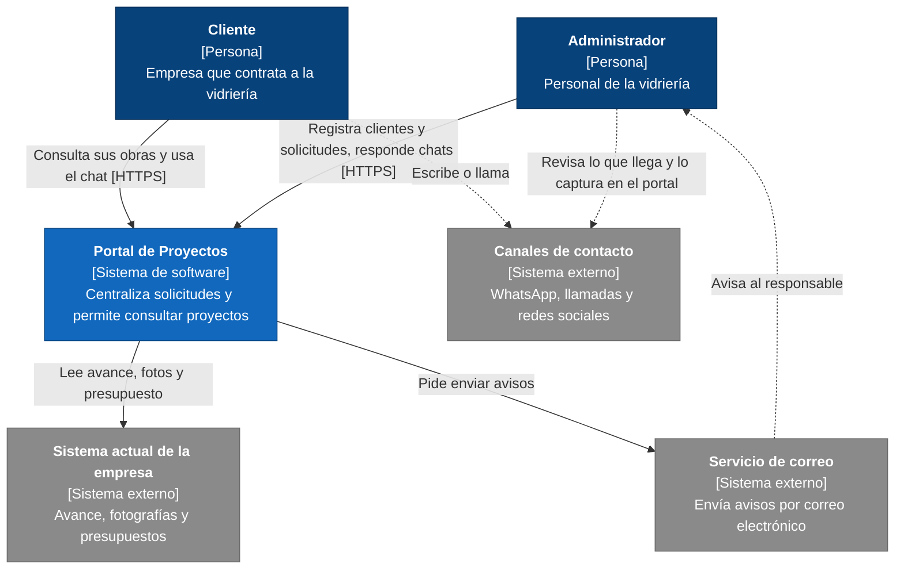

# Diagrama de contexto (C4, nivel 1)

Módulo de Comunicación con el Cliente · Equipo 3 · Grupo 711

## Qué muestra este diagrama

El modelo C4 describe un sistema en niveles, del más general al más detallado. Este es el nivel 1, el contexto: el sistema aparece como una sola caja, junto con las personas que lo usan y los sistemas externos con los que se comunica. No muestra tecnologías ni pantallas; eso está en [CONTAINERS.md](CONTAINERS.md).

Colores: azul oscuro = persona, azul = nuestro sistema, gris = sistema externo. La línea continua es comunicación a través del sistema; la punteada, comunicación fuera de él.

## Diagrama

## Personas

| Persona | Quién es | Qué hace en el sistema | Requerimientos |
| :--- | :--- | :--- | :--- |
| Administrador | Personal de la vidriería: operadores e ingenieros. | Registra clientes y solicitudes, clasifica y asigna responsables, consulta el historial y atiende mensajes. | RF-01, RF-04, RF-05, RF-06 |
| Cliente | Empresa que contrata a la vidriería (una constructora, un despacho o un negocio). | Consulta el avance de sus obras, fotografías, reportes y documentos autorizados mediante un acceso seguro. | RF-07, RF-08, RNF-06 |

## Sistemas externos

> Pendiente: tabla de sistemas externos (Jorge).

## Relaciones

> Pendiente: tabla de relaciones (Jorge).
